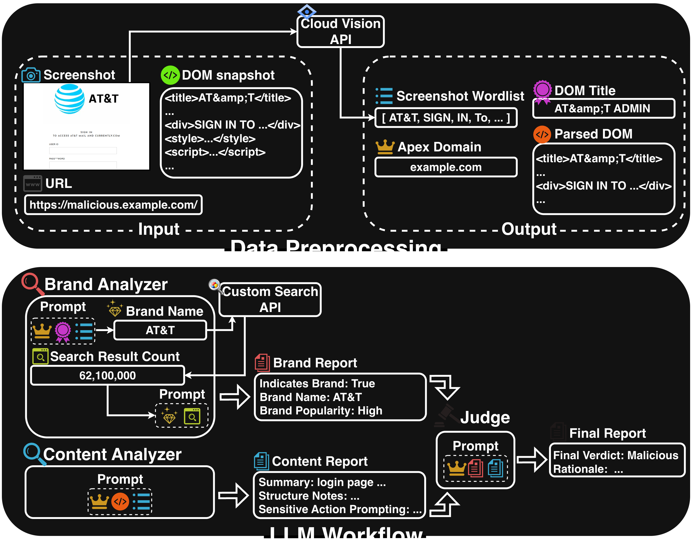

# Detecting Phishing on Shared-Domain Hosting Services Using LLM-Based Contextual Mismatch Reasoning

This repository contains the project page and the implementation for our
**ARES 2026** paper.

**Live Page**: [https://INU-SHO.github.io/shared-domain-phish-detector/](https://INU-SHO.github.io/shared-domain-phish-detector/)

## Our Proposed Method

An **LLM-workflow-based phishing detector** for shared-domain hosting services (SHSs).
Its key characteristics are:

- **Contextual mismatch reasoning**: classifies each page based on the
  *contextual mismatch* arising from the combination of *brand popularity* and
  *prompts for sensitive actions*.
- **Rationale output for explainability**: alongside the verdict, provides the
  rationale behind the decision in natural language.



## Project Structure

```
.
├── phish_detector/             # Core detection package (importable)
│   ├── workflow.py             # LangGraph DAG: Brand + Content Analyzers → Judge
│   ├── prompts.py              # PromptTemplates for the three components
│   ├── schemas.py              # Pydantic structured outputs
│   ├── runner.py               # Dataset-level driver + URL-level retry
│   ├── retry.py                # Rate-limit / transient-error retry policies
│   ├── references.py           # Loader for brand_references_*.yaml
│   ├── services.py             # Seen / Unseen services taxonomy
│   ├── dom_utils.py            # DOM simplification (Algorithm 1)
│   ├── ocr.py                  # Google Cloud Vision wrapper
│   ├── search.py               # Google Custom Search wrapper
│   ├── api_counter.py          # Per-URL Google API call counter
│   ├── url_utils.py            # Apex domain extraction (tldextract)
│   ├── io_utils.py             # CSV/JSONL I/O and resume tracking
│   └── urlscan_collector.py    # urlscan.io scraper used by scripts/collect_data.py
├── scripts/                    # Entry points for running the proposed method
│   ├── run.py                  # Run the workflow on a dataset
│   ├── evaluate.py             # Accuracy/Precision/Recall/F1 + cost/token/runtime metrics
│   └── collect_data.py         # Build a dataset from urlscan.io (Pro)
├── supplementary/              # Scripts that regenerate the appendix analyses
│   ├── statistical_tests.py    # Paired t-test and Cohen's d for Appendix A
│   ├── sensitivity_test.py     # Sensitivity analysis on reference brand choice for Appendix B
│   ├── refresh_references.py   # Refresh hit counts in brand_references_*.yaml
│   └── check_tranco_ranks.py   # Verify reference-brand domains vs Tranco list
├── configs/
│   ├── brand_references_financial.yaml         # Financial reference brands (Appendix B)
│   ├── brand_references_online_service.yaml    # Online-service reference brands (Appendix B)
│   ├── brand_references_telecommunication.yaml # Default: telecom reference brands (paper's main results)
│   └── pricing.yaml                            # USD/M-token rates for evaluate.py
├── docs/                       # Project webpage (published to GitHub Pages)
├── datasets/                   # Collected dataset lives here (gitignored; not distributed)
├── results/                    # Evaluation outputs (per-model subdirectories; gitignored)
├── figures/                    # Architecture figure used in README
├── secrets/                    # GCP service-account JSON for Vision API
├── env.example                 # Template for .env
├── pyproject.toml
└── uv.lock                     # Resolved lockfile (generated by `uv sync`)
```

## Setup

### 1. Install software

- [uv](https://docs.astral.sh/uv/getting-started/installation/) (a splendid Python package and project manager)
- [Ollama](https://ollama.com/) (an easy-to-use LLM inference engine, recommended for PCs) or [SGLang](https://docs.sglang.io/get_started/install.html) (a very fast and efficient LLM inference engine, typically used with professional GPUs) — only required if you plan to run the proposed method with Qwen3-8B

### 2. Prepare Python virtual environment

```bash
git clone https://github.com/INU-SHO/shared-domain-phish-detector.git
cd shared-domain-phish-detector
uv sync
```

### 3. Register API keys

Copy `env.example` to `.env` at the project root and fill in the keys
below.

#### 🔑 OpenAI API Key

```dotenv
OPENAI_API_KEY=
```

Issue a key from the [OpenAI platform](https://platform.openai.com/api-keys).

#### 🔑 Custom Search JSON API Key

```dotenv
GOOGLE_API_KEY=
GOOGLE_CSE_ID=
```

- **API key**: enable the
  [Custom Search API](https://developers.google.com/custom-search/v1/overview)
  and create credentials in the
  [GCP Console](https://console.cloud.google.com/apis/credentials).
- **Search engine ID**: in the
  [Programmable Search Engine control panel](https://programmablesearchengine.google.com/),
  create an engine that searches the entire web, then copy the `cx`.

#### 🔑 Google Cloud JSON Key

```dotenv
GOOGLE_APPLICATION_CREDENTIALS=
```

Set the **absolute path** to a GCP service-account JSON key file with the
[Cloud Vision API](https://console.cloud.google.com/apis/library/vision.googleapis.com)
enabled.
[Create a service account](https://console.cloud.google.com/iam-admin/serviceaccounts)
and download its JSON key.

#### 🔑 urlscan API Key

```dotenv
URLSCAN_API_KEY=
```

**Required only when collecting a fresh dataset** with
`scripts/collect_data.py` (see Step 4). The collection queries depend on
urlscan.io **Pro** features; issue a Pro-tier key from
[your urlscan.io profile](https://urlscan.io/user/profile/).

#### 🔑 LangSmith API Key (Optional)

```dotenv
LANGSMITH_API_KEY=
```

Issue a key from [LangSmith](https://smith.langchain.com/) and pass
`--trace` to `scripts/run.py` to send LangChain traces for debugging.
Without `--trace`, this key is unused.

### 4. Prepare a Dataset

**Due to copyright considerations, the evaluation dataset used in the
paper is not distributed with this repository.** Collect your own
dataset with `scripts/collect_data.py` (requires the urlscan API key
from Step 3). The runner expects the following fixed layout under
`datasets/test/`:

```
datasets/test/
├── malicious/
│   ├── url_list.csv            # columns: id,url
│   ├── html/<id>.html
│   └── screen/<id>.png
└── benign/
    ├── url_list.csv
    ├── html/<id>.html
    └── screen/<id>.png
```

`scripts/collect_data.py` produces exactly this layout:

```bash
# Test split (10 SHSs, post-2024 scans) → datasets/test/
python scripts/collect_data.py --date-from 2024-01-01

# Training split for the FreePhish baseline (17 SHSs, pre-2024 scans) → datasets/train/
python scripts/collect_data.py --hosts train --date-to 2023-12-31
```

The `malicious` / `benign` labels are urlscan-side pseudo-labels, not
strict ground truth.
**Manually verify each sample's label before running inference.**

### 5. Prepare LLM inference engine (when using Qwen3-8B)

#### Ollama

```bash
ollama pull qwen3:8b
```

#### SGLang

Serve the model through an OpenAI-compatible API:

- Qwen/Qwen3-8B
  - at `http://127.0.0.1:40000`
  - with reasoning parser

## Usage

```bash
$ uv run python scripts/run.py --help
usage: run.py [-h] --backend {openai,qwen} [--limit LIMIT] [--cycles CYCLES] [--brand-references BRAND_REFERENCES] [--trace]
              [--sglang | --ollama]

Run the phishing-detection workflow against the dataset.

options:
  -h, --help            show this help message and exit
  --backend {openai,qwen}
                        Which LLM backend to use.
  --limit LIMIT         Process at most N URLs across all splits (0 = no limit, default).
  --cycles CYCLES       Run the full evaluation N times; each cycle writes a separate, timestamped output file under
                        results/<backend>/.
  --brand-references BRAND_REFERENCES
                        YAML file of HIGH-popularity reference brands injected into the brand-analyzer prompt as scale anchors.
  --trace               Enable LangSmith tracing (requires LANGSMITH_API_KEY in .env). Off by default.
  --sglang              Serve Qwen via SGLang / vLLM through an OpenAI-compatible API (default for --backend qwen).
  --ollama              Serve Qwen via Ollama (only valid with --backend qwen).
```

### Examples

- Run the workflow against the dataset 10 times with the OpenAI backend
  ```bash
  uv run python scripts/run.py --backend openai --cycles 10
  ```
- Run with the local Qwen3-8B backend served via SGLang
  ```bash
  uv run python scripts/run.py --backend qwen --cycles 10
  ```
- Run with the local Qwen3-8B backend served via Ollama
  ```bash
  uv run python scripts/run.py --backend qwen --ollama --cycles 10
  ```
- Aggregate metrics across the produced CSVs (model inferred from each CSV's parent directory)
  ```bash
  uv run python scripts/evaluate.py results/openai/*.csv
  ```

## Citation

```bibtex
@inproceedings{inuzuka2026shs,
  author    = {Sho Inuzuka and Takaaki Toda and Daiki Chiba and Tatsuya Mori},
  title     = {{Detecting Phishing on Shared-Domain Hosting Services Using LLM-Based Contextual Mismatch Reasoning}},
  booktitle = {Proceedings of the 21st International Conference on Availability, Reliability and Security},
  year      = {2026}
}
```
